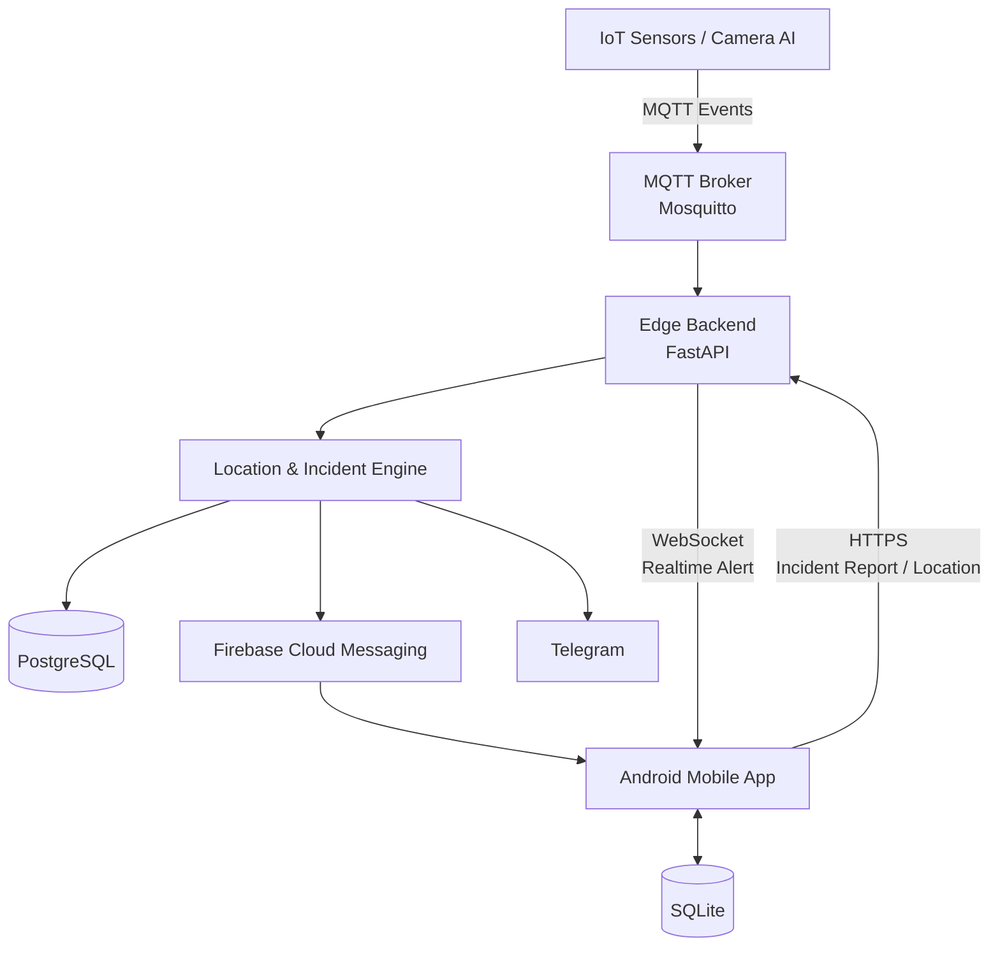

# safe-x - Smart AI Fusion at the Edge for Indoor Emergency Detection and Response

ระบบตรวจจับและแจ้งเตือนเหตุการณ์ฉุกเฉินภายในอาคาร โดยใช้แนวคิด **Edge AI / IoT + Indoor Location + Mobile Application** เพื่อให้สามารถตรวจจับเหตุการณ์ แจ้งเตือนผู้ใช้งาน และรับรายงานเหตุจากผู้ใช้ได้อย่างรวดเร็วภายในพื้นที่อาคาร

โปรเจกต์นี้เน้นการทำงานภายในอาคารในขอบเขต **1 ชั้น และ 1 ฝั่งของอาคาร** โดยมีเป้าหมายหลักคือการลด latency ของการแจ้งเหตุ และให้ระบบยังสามารถทำงานภายใน Local Network ได้แม้การเชื่อมต่ออินเทอร์เน็ตภายนอกมีปัญหา

---

## Project Scope

ระบบรองรับเหตุการณ์หลัก เช่น

- Smoke / Fire Detection
- Abnormal Temperature
- Person Fall / Unconscious Detection
- Power Failure / Device Abnormality
- Manual Incident Report จากผู้ใช้งาน

โปรเจกต์นี้ครอบคลุมเฉพาะ

**Phase 1 — IoT & Edge Infrastructure**  
**Phase 2 — Indoor Incident Monitoring**

ส่วน Outdoor Incident / Routing System อยู่นอกขอบเขตของโปรเจกต์นี้

---

## Mobile Application

Mobile App เป็นส่วนสำคัญของระบบ เพราะทำหน้าที่ทั้งเป็น

- **Incident Receiver** — รับการแจ้งเตือนเหตุการณ์แบบ Real-time
- **Indoor Location Client** — ประเมินตำแหน่งผู้ใช้จาก BLE Beacons
- **Human / Social Sensor** — ให้ผู้ใช้สามารถรายงานเหตุการณ์เข้าสู่ระบบ
- **Offline Local Storage** — เก็บข้อมูลบางส่วนใน SQLite เพื่อรองรับกรณี Network ขัดข้อง

### Main Features

- รับ Incident Alert ผ่าน WebSocket
- รับ Background Notification ผ่าน Firebase Cloud Messaging (FCM)
- แสดงตำแหน่งเหตุการณ์ภายในอาคาร
- แสดงตำแหน่งปัจจุบันของผู้ใช้จาก BLE
- รองรับ Static Floor Map
- ส่ง Social / Manual Incident Report ไปยัง Edge Server
- เก็บ Incident Cache และ Pending Report ใน SQLite
- Retry การส่ง Report เมื่อ Network กลับมา
- Synchronize Incident หลัง WebSocket reconnect

---

## System Architecture



---

## Mobile ↔ Edge Communication

Mobile App ติดต่อกับ Edge Server ผ่าน 2 ช่องทางหลัก

### WebSocket

ใช้สำหรับข้อมูลแบบ Real-time เช่น

```text
Edge Server
    ↓
Incident Alert
    ↓
Mobile App
```

ตัวอย่างข้อมูลที่ App อาจได้รับ

```json
{
  "type": "incident_alert",
  "incident": {
    "event_id": "INC-001",
    "event_type": "smoke",
    "severity": "critical",
    "status": "active",
    "location": {
      "floor": "1",
      "zone": "A03"
    }
  }
}
```

### HTTPS REST API

ใช้สำหรับข้อมูลที่ต้องการ Request / Response ชัดเจน เช่น

- ส่ง Incident Report
- ส่ง Location Update
- Incident Acknowledgement
- Initial / Recovery Synchronization

ตัวอย่างการแจ้งเหตุจาก Mobile App

```text
User
 ↓
Mobile App
 ↓
Save to SQLite
 ↓
HTTPS POST
 ↓
Edge Server
 ↓
Incident Engine
```

---

## Indoor Location

Mobile App ทำ BLE scanning จาก Beacon ที่ติดตั้งภายในอาคาร

```text
BLE Beacons
     ↓
Android BLE Scanner
     ↓
Location Estimator
     ↓
Floor / Zone / Position
     ↓
Mobile UI + Edge Server
```

ตำแหน่ง Beacon และข้อมูล Floor / Zone สามารถถูก cache ไว้ใน SQLite เพื่อลดการเรียก Server และช่วยให้การประเมินตำแหน่งทำงานได้รวดเร็วขึ้น

---

## Social Incident Reporting

ผู้ใช้งานสามารถเป็นอีกหนึ่ง Source ของระบบแบบ Multimodal

```text
IoT Sensor
     +
Camera AI
     +
Mobile User Report
     ↓
Incident Engine
     ↓
Incident Decision
```

ตัวอย่าง

```text
Smoke Sensor ตรวจพบควัน

Camera AI พบลักษณะของควัน

ผู้ใช้รายงานว่า
"เห็นควันบริเวณหน้าห้อง A305"

        ↓

Incident Engine

        ↓

Correlate ตาม
Location + Time + Event Type
```

ข้อมูลจากผู้ใช้จึงไม่ได้เป็นเพียง Feedback แต่เป็นอีกหนึ่ง Input ของระบบ Incident Detection

---

## Local Mobile Storage

Mobile App ใช้ SQLite สำหรับข้อมูลภายในเครื่อง เช่น

```text
SQLite

├── Incident Cache
├── Pending Incident Reports
├── Beacon Metadata
├── Floor / Zone Metadata
└── Sync State
```

PostgreSQL บน Edge Server ยังคงเป็น **Source of Truth** ของระบบ

SQLite มีหน้าที่เป็น Local Cache และ Offline Queue เท่านั้น

---

## Backend & Infrastructure

ระบบ Edge ใช้ส่วนประกอบหลักดังนี้

| Component | Technology |
|---|---|
| Edge Backend | FastAPI |
| IoT Messaging | MQTT / Mosquitto |
| Server Database | PostgreSQL |
| Mobile Local Database | SQLite |
| Realtime Communication | WebSocket |
| API Communication | HTTPS REST |
| Background Notification | Firebase Cloud Messaging |
| External Alert | Telegram Bot |
| Deployment Environment | Docker / Docker Compose |

---

## Main Data Flow

```text
Sensors / Camera AI
        ↓
       MQTT
        ↓
    Edge Server
        ↓
 Incident Engine
        ↓
   PostgreSQL
        ↓
 ┌──────┼────────┐
 ↓      ↓        ↓
WS     FCM    Telegram
 ↓      ↓
   Mobile App
```

ในอีกทิศทางหนึ่ง

```text
User
 ↓
Mobile App
 ↓
Social Incident Report
 ↓
HTTPS
 ↓
Edge Server
 ↓
Incident Engine
```

---

## Project Goal

เป้าหมายของระบบคือ

> Detect incidents as early as possible, process them locally at the edge, and deliver low-latency alerts to occupants and responsible personnel.

โดยเน้น

- Low Latency
- Edge Processing
- Multimodal Incident Detection
- Indoor Localization
- Real-time Mobile Alert
- Human / Social Incident Reporting
- Resilient Local Operation

---

## Project Status

🚧 **Senior Project — Prototype / Demo Development**

ปัจจุบันระบบอยู่ในขั้นออกแบบและพัฒนา Phase 1–2 โดยเน้น Indoor Incident Monitoring และ Mobile Application เป็นหลัก
